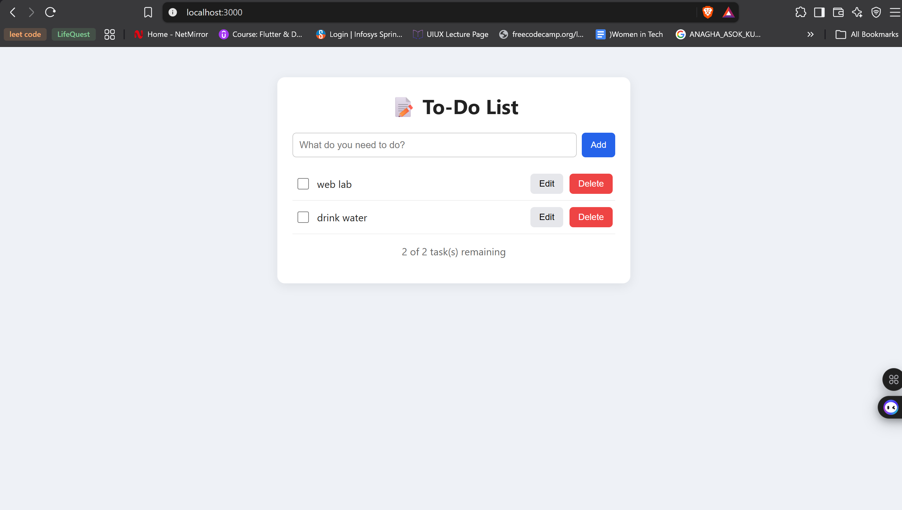
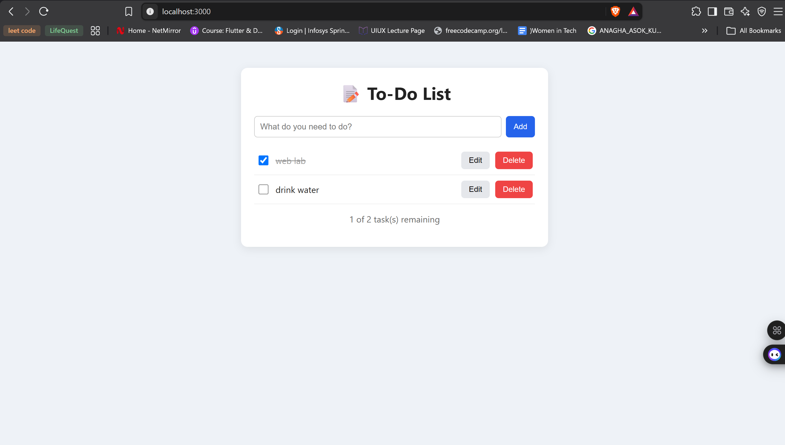
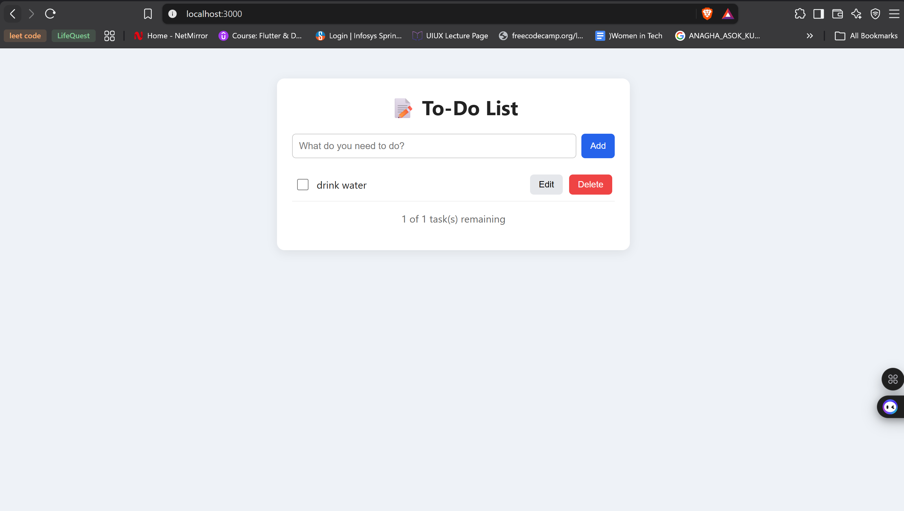

# MERN To-Do List

A full-stack To-Do List app built with **MongoDB, Express.js, React.js and Node.js**.
You can add tasks, mark them complete/incomplete, edit their title, and delete them.
Every action calls the REST API and updates the page without a reload.

## Project Structure

```
todo-mern/
├── backend/
│   ├── config/db.js          # MongoDB connection (Mongoose)
│   ├── models/Task.js        # Task schema: title, completed, createdAt
│   ├── routes/taskRoutes.js  # GET / POST / PUT / DELETE /api/tasks
│   ├── server.js             # Express app entry point
│   └── .env.example          # Environment variable template
├── frontend/
│   ├── src/
│   │   ├── api.js            # fetch() calls to the backend
│   │   ├── App.jsx           # Main component (state + handlers)
│   │   ├── components/
│   │   │   ├── TaskForm.jsx  # Form to add a task
│   │   │   └── TaskItem.jsx  # One task: checkbox, edit, delete
│   │   └── index.css
│   ├── index.html
│   └── vite.config.js
├── screenshots/
└── README.md
```

## Prerequisites

- Node.js (v18 or later)
- MongoDB, either a local install (Community Server) or a free MongoDB Atlas cluster

## How to Run

### 1. Backend

```bash
cd backend
npm install
```

Create a file named `.env` in the `backend` folder (copy `.env.example`):

```
PORT=5000
MONGO_URI=mongodb://127.0.0.1:27017/todolist
```

To use MongoDB Atlas instead, set:
`MONGO_URI=mongodb+srv://<user>:<password>@<cluster>.mongodb.net/todolist`

Make sure MongoDB is running, then start the server:

```bash
npm start        # or: npm run dev  (auto-restart with nodemon)
```

The API runs at **http://localhost:5000**.

### 2. Frontend

Open a second terminal:

```bash
cd frontend
npm install
npm start
```

Open **http://localhost:3000** in your browser.

## API Endpoints

| Method | Endpoint         | Description                          | Body example                          |
|--------|------------------|--------------------------------------|---------------------------------------|
| GET    | `/api/tasks`     | Fetch all tasks                      | —                                     |
| POST   | `/api/tasks`     | Add a new task                       | `{ "title": "Buy milk" }`             |
| PUT    | `/api/tasks/:id` | Mark complete/incomplete, edit title | `{ "completed": true }` / `{ "title": "New" }` |
| DELETE | `/api/tasks/:id` | Delete a task                        | —                                     |

## Screenshots

| Adding a task | Completing a task | Deleting a task |
|---|---|---|
|  |  |  |
